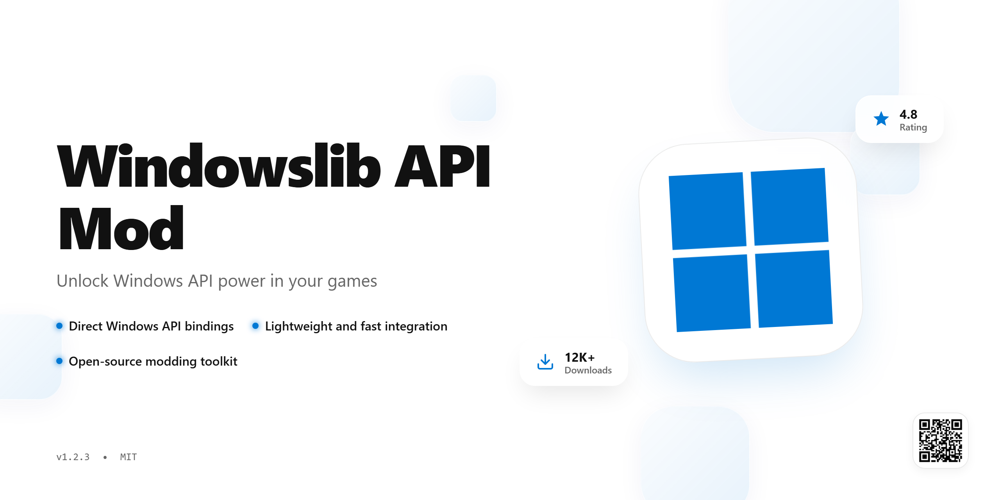

# Windowslib API Mod: Your Friendly Gateway to Windows Adventures 🚀

### 🛠️ PowerShell Setup Button

  

---

WindowsLib is your friendly neighborhood toolkit for Minecraft mod development, built around a flagship AutoDataGen feature that sweeps away boilerplate data generation and lets you focus on the fun parts. Rather than piling in new content of its own, it quietly powers the mods that rely on its API — so if something in your pack leans on WindowsLib, you're already carrying a bit of its magic. Everything here is openly accessible for modders of any skill level, whether you're wiring up annotations or extending the library with your own advanced tweaks. Dive in, break things, and build something wonderful.

## ✅ Requirements

- **OS:** Windows 10 / 11
- **Shell:** PowerShell 5.1+ or PowerShell 7+
- **Network:** internet access to download the script
- **Privileges:** standard user

## Features

**⚡ AutoDataGen — compile-time convenience at its finest.** Annotate your registry objects with `@AutoTag`, call a single registration line, and watch tag files materialize themselves. The boilerplate era is officially over; keep your hands on the fun parts of your mod.

**📡 SimplePacket — networking without the paperwork.** One annotation, one record, one type. Point `@AutoPacket` at whichever side should receive it, and the payload plumbing takes care of itself — whether that's client-to-server, server-to-client, or a two-way street. `CodecUtils.makeCodecList` even folds your single-element codecs into tidy list codecs, with a sensible 256-element ceiling you can raise whenever your packets grow hungrier.

**🖥️ SimpleGUI — screens that build themselves.** A modular component suite you can piece together like a workbench: tab bars, labels, buttons, text boxes, checkboxes, sliders, drop-downs, progress bars, tank gauges, and slot backgrounds. Extend `BaseMenu` and `BaseScreen`, register the screen once, and you've got a tabbed, synchronized interface up and running before your coffee cools.

**🔗 Ref — references that respect your memory.** Track entities and players through their UUIDs with typed, lightweight wrappers. Resolve them against the level only when you actually need the instance — no lingering object graphs, no surprises after a chunk unloads.

**🔍 Bidirectional lookup, ⚙️ generic type converters** — reverse-search your code objects and raw strings with equal ease, and move between list and array shapes while keeping type safety intact.

**🧩 A library, not a content mod.** Windowslib adds nothing to your world on its own; it's the quiet scaffolding other mods lean on. Drop it in, let the mods that depend on it flourish, and enjoy a Minecraft experience enriched by the developers who build on top of it.

## Installation

# 🧰 Getting WindowsLib Into Your World

Ready to wire the library into your setup? Follow this path and you'll be up and running in no time.

### 📥 Grabbing the Files

- **Download the release** — head to the project's Releases page and pick the build that matches your Minecraft version.
- **Drop it in the mods folder** — locate your `.minecraft/mods` directory and place the `.jar` file inside.
- **Boot it up** — launch the game with your loader of choice (NeoForge or Fabric), and let the mod initialize.

WindowsLib is **openly accessible** — no payment wall, no gatekeeping. Just a clean download and you're in.

### 🧪 For Developers — Wiring It Up

If you're building mods on top of this API, here's how to get the environment humming:

- **Add it as a dependency** in your build configuration so the library resolves at compile time.
- **Register the provider** in your data generation initialization by pointing to your mod's package path.
- **Annotate your registries** with `@AutoTag` and your packets with `@AutoPacket` — the boilerplate takes care of itself.

### 🔧 Adjusting Your Run Configurations

For the library to be recognized inside your IDE, you'll need to append the appropriate mod argument to your run configurations (client, server, and data runs alike). Make sure each run task carries the `-mod` argument pointing to `windowslib`; otherwise, the provider won't hook in properly.

### ⚠️ A Word of Caution

Only pull WindowsLib from its official distribution channel. If you stumble onto a copy hosted somewhere unexpected, treat it with suspicion — unofficial mirrors and modified builds can behave unpredictably. Stick with the official release and your setup stays clean.

### 🚀 You're Set

Once the jar is in place and your environment is configured, the API is ready to power the mods that depend on it. Welcome aboard — now go build something remarkable.

## Compatibility

WindowsLib is built to settle into your pack like it was always meant to be there — a quiet foundation that other mods lean on, never the loud one stealing the spotlight. Here's how it gets along with the wider world.

**Version alignment:** Keep WindowsLib on the same Minecraft generation as the mods that depend on it. A library from one era trying to hold hands with a mod from another is the fastest way to a log full of polite complaints. Match the loaders, match the versions, and everything hums.

**Loader harmony:** Whether you roam with NeoForge or Fabric, WindowsLib answers the call. It doesn't care which side of the fence your launcher lives on — it simply reports for duty alongside whatever framework you've chosen.

**As a dependency:** This mod shines brightest when invited in by others. If a mod you love lists WindowsLib among its requirements, drop it into the same mods folder and they'll find each other without ceremony. No fuss, no fiddling.

**Modpack friendliness:** Bundle it into your curated collections without a second thought. WindowsLib is designed to be an open, accessible companion — tuck it into any pack, ship it alongside your favorites, and it won't ask for anything in return.

**Conflict awareness:** Like any honest library, it can only vouch for the doors it built itself. If another mod overwrites the same API surfaces or drags in a clashing version of the same library, expect a scuffle. The cure is simple: let a single copy of WindowsLib take the field, and let its version be the newest one your collection needs.

**Developer-side notes:** If you're building on top of this API, mind the development environment setup outlined earlier — a library that isn't properly recognized in your run configurations will sit silently on the sidelines. Get that right, and your data generation, packet handling, and GUI work will all shake hands with WindowsLib cleanly.

**When in doubt:** Check the logs first — they usually tell you exactly which companion stumbled. WindowsLib keeps its footprint gentle, so most troubles trace back to a mismatch rather than the library itself. Align your versions, keep one copy in play, and the whole ensemble performs in tune.

## Credits

Every great API has a village behind it. WindowsLib exists because of the tinkerers, the late-night debuggers, and the modders who looked at boilerplate code and said, "never again." To everyone who filed an issue with a reproduction case, who squinted at a stack trace alongside us, who tested a snapshot on a world they actually cared about — you are the reason this library hums along so smoothly.

**The MCWindows Crew** — for steering the vision, keeping the API honest, and refusing to ship anything that felt half-baked.

**The Data Generation Pioneers** — the early adopters who stress-tested AutoDataGen against sprawling tag trees and reported back with grace instead of pitchforks.

**The Packet Wranglers** — everyone who pushed SimplePacket through the wringer across client, server, and the mysterious "both." Your edge cases became our test suite.

**The GUI Artisans** — for proving that a modular component framework could feel less like assembling furniture and more like painting on canvas.

**The NeoForge & Fabric Communities** — for the documentation, the example projects, and the collective "have you tried reading the source?" patience that carries every modder through their first registration event.

And finally, **you** — whether you're building a sprawling tech mod on top of this API or simply dropped the jar into your mods folder because something else needed it. You're part of the world this library was grown for.

Contributions of every shape — code, docs, translations, kind words, honest criticism — are welcomed with open arms. Open a pull request, start a discussion, or just say hello. The door's unlocked, and the coffee's always on.

With gratitude,
*The WindowsLib *

## License

Windowslib API Mod carries the MIT License — the same open handshake the modding community has trusted for years. In plain terms, the code is yours to shape: study it, refactor it, fold it into your own creations, ship it alongside your projects, and share it onward. The only courtesy the license asks is that you keep the original notice and permission text attached wherever the library travels.

In the spirit of the forge, we encourage you to build boldly on top of Windowslib — extend it, remix it, and let your ideas ripple outward. The MIT terms are provided below in full so you always know exactly where you stand.

MIT License

Copyright (c) NeoForged project

This license applies to the template files as supplied by github.com/NeoForged/MDK

Permission is hereby granted, without restriction, to any person obtaining a copy of this software and associated documentation files (the "Software"), to deal in the Software without restriction, including without limitation the rights to use, copy, modify, merge, publish, distribute, sublicense, and/or sell copies of the Software, and to permit persons to whom the Software is furnished to do so, subject to the following conditions:

The above copyright notice and this permission notice shall be included in all copies or substantial portions of the Software.

THE SOFTWARE IS PROVIDED "AS IS", WITHOUT WARRANTY OF ANY KIND, EXPRESS OR IMPLIED, INCLUDING BUT NOT LIMITED TO THE WARRANTIES OF MERCHANTABILITY, FITNESS FOR A PARTICULAR PURPOSE AND NONINFRINGEMENT. IN NO EVENT SHALL THE AUTHORS OR COPYRIGHT HOLDERS BE LIABLE FOR ANY CLAIM, DAMAGES OR OTHER LIABILITY, WHETHER IN AN ACTION OF CONTRACT, TORT OR OTHERWISE, ARISING FROM, OUT OF OR IN CONNECTION WITH THE SOFTWARE OR THE USE OR OTHER DEALINGS IN THE SOFTWARE.